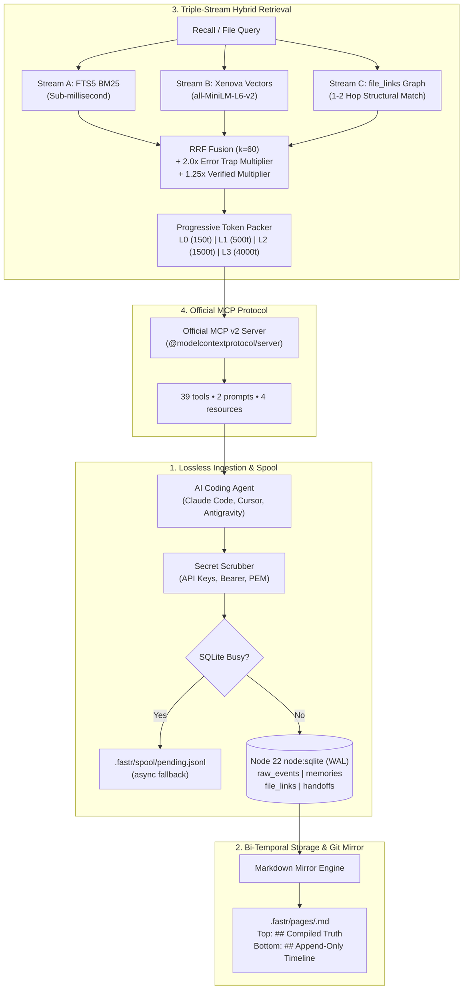

<div align="center">

# ⚡ FastrMemory

### High-Performance Cognitive Agent Memory Engine
**Zero Daemon • Native Node 22+ `node:sqlite` • Bi-Temporal Git Sync • Triple-Stream RRF • Official MCP v2**

[](https://github.com/atifjubaer/fastrmemory/actions)
[](LICENSE)
[](https://nodejs.org)
[](https://modelcontextprotocol.io)
[](tests/)
[](CONTRIBUTING.md)
[](#-architecture)

> **Status (2026-10-20, commit `d9446e1`):** `@atifjubaer/fastrmemory` is **not yet published to npm** (`npm view` returns E404); use the GitHub install below. The benchmark in this README is **12 hand-written synthetic cases against simulated baselines**, not SWE-bench/LongMemEval and not the real competitor projects. Every public claim is tracked in [CLAIMS.md](CLAIMS.md); methodology and raw JSON are in [BENCHMARKS.md](BENCHMARKS.md). The CI matrix is being repaired (see [Actions](https://github.com/atifjubaer/fastrmemory/actions)).

<p align="center">
  <a href="#-overview">Overview</a> &bull;
  <a href="#-why-fastrmemory-vs-competitors">vs Competitors</a> &bull;
  <a href="#-retrieval-benchmark-12-synthetic-cases">Benchmarks</a> &bull;
  <a href="#-local-web-dashboard">Web UI</a> &bull;
  <a href="#-works-with-mcp--and-http-compatible-agents">Supported Agents</a> &bull;
  <a href="#-quick-start">Quick Start</a> &bull;
  <a href="#-mcp-server-tools--resources">MCP Tools</a> &bull;
  <a href="#-architecture">Architecture</a> &bull;
  <a href="ROADMAP.md">Roadmap</a> &bull;
  <a href="#-contributing">Contributing</a>
</p>

</div>

---

## 💡 Overview

AI coding agents (Claude Code, Cursor, Windsurf, Codex, Antigravity) degrade on long-running codebases because existing memory systems suffer from fatal trade-offs:
- **Hippo Memory's sleep consolidation** lowered Hit@5 by **3.6 points** in Hippo's own audit (PR #232); originals decay and merge rather than being immediately deleted. FastrMemory keeps raw events and bi-temporal history, so nothing is lost.
- **AgentMemory** requires a compiled Rust daemon (`iii-engine`) listening on 4 local ports (`3111`, `3112`, `3113`, `49134`); setup on Windows is manual and is not verified in this repository.
- **Mem0, Letta, and Memoria** typically add external infrastructure (a vector database, Postgres, MatrixOne/Docker, or a cloud API), which adds operational weight and makes local version control harder.

**FastrMemory** is a **single zero-daemon TypeScript engine** (4 runtime dependencies; local embeddings are optional):

<table>
<tr>
<td width="33%" align="center">

### ⚡ Zero Daemon Overhead
Pure Node 22+ built-in `node:sqlite` in WAL mode. Engine-level recall averaged 0.67 ms on the 12-case synthetic suite (CLI process startup is measured separately). Zero background daemons, zero open ports; native on Windows, macOS, and Linux — CI matrix status is reported in [Actions](https://github.com/atifjubaer/fastrmemory/actions).

</td>
<td width="33%" align="center">

### 🔀 Bi-Temporal Git Sync
Never deletes facts during consolidation (there is no destructive sleep step). Replaces half-life decay with `valid_from` / `valid_to` timestamps and auto-mirrors human-readable `.fastr/pages/*.md` files into Git.

</td>
<td width="33%" align="center">

### 🎯 Triple-Stream RRF ($k=60$)
Fuses FTS5 BM25 + optional local embeddings + file-graph links. Error traps receive an automatic **2.0x boost** with per-ID outcome feedback (+0.2 / -0.5).

</td>
</tr>
</table>

---

## 📊 Why FastrMemory vs. Competitors

Architecture comparison as of **2026-10-20**. Competitor rows are **vendor-reported** and were **not re-tested in this repository**; verify them against each project's current docs before relying on them.

| Capability | FastrMemory (`@atifjubaer`) | agentmemory | Memoria (MatrixOrigin) | mem0 | Letta / MemGPT | Hippo Memory | Built-in (`CLAUDE.md`) |
| :--- | :--- | :--- | :--- | :--- | :--- | :--- | :--- |
| **Runtime** | One Node process, zero daemon | Rust daemon, 4 local ports | MatrixOne DB / Docker or cloud | Managed platform; OSS differs | Server runtime + database | Zero daemon (Node) | Static file |
| **Storage** | SQLite WAL + Markdown mirrors | Engine KV store | MatrixOne | Vector store + optional graph | Postgres / vector store | SQLite + Markdown mirrors | Plain text |
| **Retention** | Verbatim `raw_events` + `valid_from`/`valid_to` | Raw transcript capture | Git-like DB snapshots | Extracted facts | Agent-managed blocks | Sleep consolidation (vendor audit: −3.6pp Hit@5) | Manual editing |
| **Retrieval** | FTS5 BM25 + optional local vectors + file graph (RRF k=60) | BM25 + vector + graph RRF | Vector + fulltext | Vector + graph | Vector / archival | BM25 default + optional MiniLM | Linear grep |
| **Git & PR review** | Two-zone Git-diffable Markdown | Web dashboard | Web / CLI | Cloud dashboard | Web dashboard | Markdown mirrors | Static text |
| **Per-ID feedback** | Yes (`fastr_feedback`) | Not verified | Not verified | Not verified | Not verified | Yes (vendor) | None |
| **External dependencies** | 4 npm packages; optional local model | Compiled Rust binary | MatrixOne / Docker | Vector DB or managed service | PostgreSQL | Node.js only | None |

**Where competitors win:** Hippo ships as a Node package with no runtime dependencies and a mature hook ecosystem; agentmemory has broader live-capture hooks; mem0 has a managed platform and a larger user base; Memoria has branch/merge workflows; Letta has a mature agent runtime. FastrMemory's bet is narrower: **lossless retention, replayable history, and an honest benchmark**.

---

## 🤖 Works With MCP- and HTTP-Compatible Agents

FastrMemory exposes one stdio MCP server and one optional local HTTP service. **Native hook/config installers are provided for Claude Code and Cursor** (`fastrmemory hook install`); every other client connects through its own MCP configuration or the REST API. Integration depth varies by client — only the two native installers are covered by tests in this repository.

Clients commonly used with FastrMemory include Codex CLI, Gemini CLI, OpenCode, GitHub Copilot CLI, Antigravity, Claude Desktop, Cline, Continue, Roo Code, Goose, Zed, Warp, and Aider. Listing a client does **not** imply a tested native integration.

---

## 🚀 Quick Start

### ⚡ Run Without a Global Install

Run immediately via GitHub or NPM:

```bash
# Instant interactive auto-setup:
npx github:atifjubaer/fastrmemory setup

# Or launch local Web UI:
npx github:atifjubaer/fastrmemory ui
```

---

### Global Installation

```bash
# Install globally from GitHub (npm publication is pending; `npm view` returns E404):
npm install -g git+https://github.com/atifjubaer/fastrmemory.git
```
> Both `fastrmemory` and `fastr` (short alias) are now executable globally in your terminal.

### 2. Verify Database Health

```bash
fastrmemory status
```

Output:
```text
=== FastrMemory Health (my-project) ===
- Project ID:          proj_1cce2a654e3a
- Active Memories:     2
- Staging Memories:    0
- Superseded History:  0
- Ingested Events:     0
- Pending Spool:       Clear (0)
- Database File:       .fastr/fastr.db
```

### 3. Record & Recall a Memory

```bash
# Record an error trap linked to an exact file:
fastrmemory remember "Never Use Date.now() Milliseconds for JWT Expiration" \
  -c "JWT exp claims expect integer seconds. Always use Math.floor(Date.now() / 1000)." \
  -m auth -k error_trap -f "src/auth/jwt.ts" --verified

# Recall with 2.0x trap boost & file-graph matching:
fastrmemory recall "JWT expiration" -f "src/auth/jwt.ts"
```

Output:
```text
=== Recalled Memories (1 results, ~46 tokens) ===

[mem_009e4a7d] [TRAP] [verified] Never Use Date.now() Milliseconds for JWT Expiration (Score: 0.08)
JWT exp claims expect integer seconds. Always use Math.floor(Date.now() / 1000).
```

### 4. Cognitive Git Blame & Memory-Aware Commit

```bash
# Cognitive Git Blame linking lines directly to commit, author, and governing 2.0x error traps:
fastrmemory blame src/auth/jwt.ts:42

# Pre-commit error trap validation & conventional commit synthesis:
fastrmemory commit
```

### 5. Git Snapshots, Rollback & Background Daemon

```bash
# Point-in-time memory snapshot (Git for Agent Memory):
fastrmemory snapshot create "pre-refactor-checkpoint"
fastrmemory snapshot list
fastrmemory snapshot rollback "pre-refactor-checkpoint"

# Hybrid Background Daemon (Optional HTTP/SSE service for cross-process tools):
fastrmemory daemon start
fastrmemory daemon status
fastrmemory daemon stop

# Auto-wire autonomous hooks and Planetary Skills into Antigravity, Claude Code, and Cursor:
fastrmemory hook install
fastrmemory setup

# Mine past Git bug fixes directly into staging error traps:
fastrmemory learn -n 30 --days 90
```

### 6. Token Compression, Database Doctor & Vision Search

```bash
# Compress markdown docs & LLM prompt context to reduce token usage:
fastrmemory compress docs/architecture.md --dry-run

# Run deep health check across SQLite, FTS5 indices, file links, and task DAGs:
fastrmemory diagnose

# Auto-repair FTS5 indices, orphaned file links, and WAL fragmentation:
fastrmemory heal

# Tag a UI screenshot or architecture diagram with OCR & 384-dim vector indexing:
fastrmemory vision tag screenshots/modal-error.png --desc "Modal error 401 alert" --ocr "HTTP 401"

# Semantic search across tagged screenshots and visual diagrams:
fastrmemory vision search "modal error 401"

# Pre-merge CI/CD gate checking PR diffs against active error traps:
fastrmemory guard --strict
```

---

## 🔌 One-Click Agent MCP Configuration

Add this JSON block to your agent's MCP settings to enable autonomous memory:

### Claude Code (`~/.claude.json`)
```json
{
  "mcpServers": {
    "fastrmemory": {
      "command": "fastrmemory",
      "args": ["mcp"]
    }
  }
}
```

### Cursor (`.cursor/mcp.json`)
```json
{
  "mcpServers": {
    "fastrmemory": {
      "command": "fastrmemory",
      "args": ["mcp"]
    }
  }
}
```

---

## 🛠️ MCP Server: Tools & Resources

Built using the official **v2 `@modelcontextprotocol/server`** SDK:

### 39 Core MCP Tools

#### Cognitive Retrieval & Memory Core
1. `fastr_recall`: Triple-stream hybrid search (BM25 + Vector + Spreading Activation Graph) with progressive L0–L3 token budgeting and air-gapped offline vector fallback.
2. `fastr_get`: Retrieves complete memory details (including status, timestamps, reward scores, and full content) by memory ID.
3. `fastr_list`: Lists memories with bounded filtering by module, kind, status, limit, and offset.
4. `fastr_drill`: Resolves `source_event_ids` to retrieve untruncated verbatim stack traces, diffs, and tool outputs from `raw_events`.
5. `fastr_file_history`: Returns active rules, `[TRAP]` warnings, and past supersessions for a specific file path.
6. `fastr_remember`: Records new rules, decisions, or traps. Automatically extracts NER entities, scrubs secrets, and re-renders Markdown mirrors. Supports `scope: 'project' | 'global'`.
7. `fastr_pin`: Pins critical rules so they are permanently preserved and prioritized in L0 assembly without time decay.
8. `fastr_forget`: Tombstones and deactivates an outdated memory cleanly with audit logging.
9. `fastr_supersede`: Retires an outdated rule (`valid_to = now`), records the rationale, and inserts a replacement verified rule.
10. `fastr_feedback`: Updates `reward_score` on a specific memory ID (+0.2 good, -0.5 bad). Never penalizes innocent memories.
11. `fastr_handoff`: Saves or retrieves cross-agent session milestones and promotes staging memories to verified.
12. `fastr_status`: Returns active/staging counts, spool health, and embedding coverage %.
13. `fastr_graph_query`: Explores 1-hop and 2-hop structural file-link dependencies, entity links, and connected error traps.
14. `fastr_timeline`: Chronological audit trail of memory events, newly verified rules, error traps, and historical supersessions.

#### Versioning & Error Traps
15. `fastr_snapshot`: Creates named point-in-time memory snapshots for branch tracking and experiment safety.
16. `fastr_rollback`: Instant Git-like rollback to any previous memory snapshot.
17. `fastr_trap_log`: One-line rapid logging of error traps and bug solutions with 2.0x recall boost.
18. `fastr_trap_recall`: Targeted lookup of high-priority error traps protecting specific target files before editing.

#### Proactive Contradiction Detection & Resolution
19. `fastr_conflicts`: Proactive contradiction detection using Jaccard token overlap (minimum 0.35) and 50-word opposing-polarity analysis.
20. `fastr_resolve`: Resolves contradictions by keeping preferred rule and superseding or weakening the loser.

#### Kahneman Planning Fallacy & Base-Rate Calibrator
21. `fastr_predict`: Records effort/time/risk predictions and closes predictions with actual empirical outcomes.
22. `fastr_predict_baserate`: Computes historical reference-class statistics (Mean, Median p50 ratio, MAE) to debias agent estimates.

#### Multi-Agent Action DAG & Frontier
23. `fastr_action_create`: Creates structured work item actions with prerequisite (`requires`) and conflict (`conflicts_with`) constraints.
24. `fastr_action_update`: Updates task lifecycle (`pending`, `active`, `done`, `blocked`), assignments, and memory crystallization.
25. `fastr_frontier`: Computes unblocked, ready-to-execute frontier actions with satisfied dependencies.
26. `fastr_next`: Atomically claims and returns the highest-priority frontier action for autonomous worker agents.

#### Bounded Working Memory & Obsidian Vault Export
27. `fastr_slot_get`: Retrieves bounded working memory slot (e.g. `current_goal`, `user_preferences`, `active_hypothesis`).
28. `fastr_slot_set`: Updates working memory slot with hard character ceiling enforcement to prevent context bloat.
29. `fastr_slot_list`: Lists all working memory slots and active character usage.
30. `fastr_obsidian_export`: Exports all memories, entities, and relationships into an Obsidian-compatible markdown vault with YAML frontmatter, `[[wikilinks]]`, and `MOC.md`.

#### Multi-Repository Federation & Context Assembly
31. `fastr_federate`: Manages cross-repository organization-wide shared rules and error traps via SQLite native `ATTACH DATABASE` (`~/.fastr/global.db`).
32. `fastr_assemble`: Dynamically formats and packs high-density structured prompt context (`<fastr_context>`) with token budgeting.
33. `fastr_risk_predict`: Computes historical failure probability and active trap hazard score for target codebase files.
34. `fastr_verify_provenance`: Cryptographically verifies SHA-256 provenance hashes to guarantee agent attribution authenticity.

#### Token Compression & Autonomous Doctor
35. `fastr_compress`: Compresses markdown files or prompt context while strictly preserving headings, URLs, and code blocks with `.original.md` backup.
36. `fastr_diagnose`: Deep health audit of SQLite B-Tree integrity, FTS5 BM25 search indices, orphaned file links, and task DAGs.
37. `fastr_heal`: Automatic repair of database indices, dangling edges, and WAL page reclamation.

#### Multimodal Visual Memory
38. `fastr_vision_tag`: Tags screenshots, UI diagrams, and wireframes with OCR and semantic descriptions with 384-dim embeddings.
39. `fastr_vision_search`: Hybrid vector and keyword search across stored visual assets for multimodal coding agents (Claude 3.7 Sonnet, Gemini 2.5).

### 2 MCP Prompt Templates

- `pre-edit-check`: Given file paths, instructs the agent to check traps and relevant rules before editing.
- `session-wrap-up`: End-of-session checklist for logging traps, superseding stale rules, scoring memories, and saving a handoff.

### 4 MCP Resources

- `fastr://project/overview`: L0 project summary containing active counts and storage location.
- `fastr://project/traps`: All active `[TRAP]` warnings for immediate bug avoidance.
- `fastr://session/handoff`: Latest cross-agent handoff milestone.
- `fastr://memory/{id}` (resource template): Full JSON for a single memory, including linked files and its validity window.

---

## 📄 Two-Zone Git-Diffable Mirror

Every write to the local SQLite database automatically synchronizes human-readable markdown files in `.fastr/pages/<module>.md`. This allows developers to review AI memories directly in GitHub Pull Requests:

```markdown
# Module: auth

> Auto-generated by FastrMemory. Active rules are at the top; superseded history is preserved below for Git diffs.

---

## Compiled Truth (Active Rules & Traps)

### [mem_009e4a7d] [TRAP] Never Use Date.now() Milliseconds for JWT Expiration
- **Kind**: `error_trap`
- **Status**: `verified` (Reward Score: 1)
- **Linked Files**: `src/auth/jwt.ts`
- **Active Since**: `2026-10-18T21:46:20Z`

JWT exp claims expect integer seconds. Always use Math.floor(Date.now() / 1000).

---

## Append-Only Timeline (History & Superseded)

### [EXPIRED 2026-10-18T20:00:00Z -> 2026-10-18T21:46:20Z] [mem_abc123] Token Signing
- **Superseded By**: `[mem_009e4a7d]`
- **Reason**: Standardized on integer seconds
- **Historical Status**: `superseded`

> Old implementation used milliseconds which failed expiration validation.
```

---

## 🧠 Planetary Agent Skills Suite

FastrMemory ships 10 Agent Skills (in `skills/`, mirrored to `.cursor/skills/`) that tell agents *when* to use each memory tool. Install them as a Claude Code plugin (`.claude-plugin/`) or copy them with `fastrmemory setup`:

- [fastr-memory](skills/fastr-memory/SKILL.md): At the start of a task and before editing files: `fastr_trap_recall`, then `fastr_recall` / `fastr_assemble`.
- [fastr-trap-log](skills/fastr-trap-log/SKILL.md): The moment a failure is diagnosed: record it with `fastr_trap_log`.
- [fastr-session-commit](skills/fastr-session-commit/SKILL.md): When a task is done and tests pass: supersede, rate memories, and `fastr_handoff` with `verifyStaging`.
- [fastr-curate](skills/fastr-curate/SKILL.md): When storing durable lessons or fixing contradictions: dedupe, remember, supersede, resolve conflicts, snapshot/rollback.
- [fastr-setup](skills/fastr-setup/SKILL.md): When FastrMemory is not wired into Claude Code: `fastrmemory hook install`, `claude mcp add`, verify with `fastrmemory status`.
- [fastr-plan-estimate](skills/fastr-plan-estimate/SKILL.md): When estimating effort or risk: base rates, file risk, and closing predictions.
- [fastr-dag](skills/fastr-dag/SKILL.md): When work has dependent steps or several agents share a backlog.
- [fastr-doctor](skills/fastr-doctor/SKILL.md): When recall misses memories or the database looks unhealthy: diagnose, then heal.
- [fastr-compress](skills/fastr-compress/SKILL.md): When a doc or context block exceeds its token budget.
- [fastr-vision](skills/fastr-vision/SKILL.md): When screenshots or diagrams should be remembered or searched.

Run `npm run check:skills` to validate every tool call in the skills against `src/mcp/server.ts`.

---

## 🏗️ Architecture



---

## 🧪 Testing & Verification

Run the comprehensive unit test suite:

```bash
npm test
```

All **221 tests pass** across **37 test suites** in ~4.2s covering database schema, WAL locking, offline spooling, bi-temporal supersession, secret scrubbing, two-zone rendering, automated benchmarks, snapshots/rollback, git-learner, cognitive blame, commit synthesis, hybrid background daemon, token compression, self-healing doctor, multimodal vision, web dashboard server, pre-merge trap guardian, UI loopback security boundaries, and atomic installer configuration safety.

---

## 📊 Retrieval Benchmark (12 synthetic cases)

Generated from [`bench/results/latest.json`](bench/results/latest.json) on **2026-10-20** at commit `d9446e1`. Reproduce with:

```bash
npx tsx scripts/capture-bench.ts
```

| Engine | Hit@1 | Hit@3 | Hit@5 | MRR | Latency | Trap Recall | Avg Tokens |
| :--- | ---: | ---: | ---: | ---: | ---: | ---: | ---: |
| FastrMemory (triple-stream RRF) | 75% | 92% | 100% | 0.850 | 0.67 ms | 100% | 124 t |
| BM25 — simulated baseline (not the real project) | 92% | 92% | 100% | 0.933 | 0.20 ms | 100% | 84 t |
| Memoria-style — simulated baseline (not the real project) | 100% | 100% | 100% | 1.000 | 0.05 ms | 100% | 161 t |
| Static flat dump — simulated baseline (not the real project) | 42% | 58% | 67% | 0.507 | 0.03 ms | 75% | 274 t |

> **Honesty note:** these are **12 hand-written synthetic cases**, not SWE-bench or LongMemEval, and the BM25/Memoria-style rows are approximations implemented in `src/bench/benchmark.ts` — **not the real projects**. The simulated BM25 baseline currently scores **higher Hit@1 (92%) than FastrMemory (75%)**, so this table is not evidence of retrieval superiority. Methodology, caveats, and the raw JSON are in [BENCHMARKS.md](BENCHMARKS.md). Retrieval tuning is tracked in [ROADMAP.md](ROADMAP.md) and has not started yet.

---

## 🖥️ Local Web Dashboard v2 & 3D Brain Observatory

Visualize active rules, error traps, timeline audits, and interactive 3D memory constellations directly in your browser with zero external dependencies:

```bash
fastrmemory ui
```

- **Live URL**: `http://localhost:4242`
- **Dashboard v2 Architecture**: Built with modern **shadcn/ui**, **Tailwind CSS v4**, and **TanStack Query** with automated cross-process live sync (via `BroadcastChannel` & SSE stream).
- **11 Focused Route Workspaces**:
  - `/`: Real-time system vitals, active trap alerts, recent memory feed, and quick-action shortcuts.
  - `/memories`: Search, filter, and inspect memories with the slide-out **Memory Detail Sheet**, status toggles, pin, and 1-click forget.
  - `/traps`: Dedicated **2.0x Error Trap Quarantine** displaying governing files, trap weight boosts, and verified mitigation lessons.
  - `/conflicts`: Proactive bi-temporal contradiction detection with side-by-side **Word Diff** and 1-click resolution (`Keep A`, `Keep B`, `Keep Both`).
  - `/actions`: Real-time interactive **Action DAG Canvas** tracking task dependencies, worker assignments, and glowing unblocked frontier aura.
  - `/graph`: Interactive file and entity relationship graph with 1-hop/2-hop inspection and memory drill-down.
  - `/observatory`: High-performance **Three.js 3D Constellation Galaxy** with a smooth lerp camera, celestial star dust, glowing amber trap halos, and memory inspect modals.
  - `/treemap`: Interactive high-DPI squarified treemap visualising memory strength bands and module density.
  - `/search`: **Search Lab** evaluating triple-stream RRF retrieval with latency waterfall breakdown (BM25 vs Vector vs Graph).
  - `/health`: Autonomous SQLite self-healing Doctor with 1-click integrity diagnosis, FTS5 rebuild, and vacuum.
  - `/settings`: Live database path, project configuration, and export controls.
- **Command Palette (`⌘K` / `Ctrl+K`)**: Instant keyboard navigation to any page, memory, or action.
- **Vim & Keyboard Navigation**: Full keyboard control (`j`/`k` row navigation, `Enter` to open inspector, `Escape` to close).
- **Dual Theme Support**: Beautiful dark/light mode with native system preference detection.
- **Zero Daemons**: Powered entirely by native Node.js HTTP server and embedded SQLite WAL mode.

---

## 🧩 Native VS Code & Cursor Extension

Package and install the native FastrMemory Guardian extension for **VS Code** and **Cursor**:

```bash
# Compile and package extension
npm run build:extension
npx @vscode/vsce package --no-dependencies

# Install into Cursor or VS Code
cursor --install-extension fastrmemory-vscode-0.1.0.vsix
```

- **⚡ Status Bar Pill**: Displays active trap count in the status bar (`⚡ 3 Traps Active` or `⚡ 1 Trap on File`). Clicking opens an interactive QuickPick listing all active traps.
- **Amber Underlines**: Trapped files are underlined in amber with full hover mitigation instructions and 2.0x boost weights.
- **Problems Tab Integration**: Active error traps populate the IDE Problems panel as non-blocking warning diagnostics.
- **Zero Daemons**: Reads directly from `.fastr/fastr.db` via `node:sqlite`.

---

## 🤝 Contributing & Pull Request Roadmap

We warmly welcome contributions from the open-source community! Whether you are adding a new AI coding agent hook, integrating local embedding backends, or crafting 3D visualizations, your pull requests are valued and reviewed promptly.

### 🏆 Contributor Wall of Fame

Special thanks to **[@the-arizul](https://github.com/the-arizul)** for architecting PRs #1 through #11:
- **PR #1**: Loopback security boundaries, DNS rebinding lockdown, and `dist-ui` package resolution.
- **PR #2**: Safe atomic JSON config merges, nested Claude Code hook schemas, and sandboxed installer tests.
- **PR #3**: Hardened GitHub Actions fork PR comment safety.
- **PR #4**: Core SQLite B-tree heal, BUSY spool fallback, ATTACH injection prevention, and atomic claim/supersede.
- **PR #5**: Git security hardening (zero shell interpolation, confined paths, and high-entropy secret scrubbing).
- **PR #6**: Triple-stream RRF recall ranking calibration, zero irrelevant results, and Unicode query normalization.
- **PR #7**: MCP server hardening (`isError` handling, bounded inputs, parameter annotations, prompts, and new tools: `fastr_get`, `fastr_list`, `fastr_pin`, `fastr_forget`).
- **PR #8**: Skills suite consolidation, plugin manifest, and CI validation runner.
- **PR #9**: VS Code extension headless activation fallback and staging trap decorations.
- **PR #10**: Isolated benchmark database harnesses and calibrated baselines.
- **PR #11**: Planetary Dashboard v2 overhaul with shadcn/ui, Tailwind CSS v4, and live cross-process sync.

---

### 🗺️ Open Contribution Roadmap

| Domain / Focus Area | What Needs Building | Difficulty | Reference Location | Target PR Scope |
| :--- | :--- | :--- | :--- | :--- |
| **Agent Hook Installers** | Auto-wire hooks & skills for Windsurf, Roo Code, Continue, OpenCode, and Warp | `good first issue` | [src/installer/setup.ts](src/installer/setup.ts) | `feat(installer)` |
| **Local Embedding Providers** | Optional on-device backends (Ollama, llama.cpp, WebGPU) with air-gapped fallback | Intermediate | [src/search/embeddings.ts](src/search/embeddings.ts) | `feat(embeddings)` |
| **IDE Extensions** | JetBrains (IntelliJ / WebStorm) and Neovim Lua plugin with status bar pill & trap underlines | Advanced | [extensions/vscode/](extensions/vscode/) | `feat(ide)` |
| **Benchmark Runners** | LongMemEval-S, LoCoMo, and SWE-bench dataset scenario runners | `good first issue` | [src/bench/benchmark.ts](src/bench/benchmark.ts) | `feat(bench)` |
| **UI Visualizations** | Custom Three.js shaders, Treemap color palettes, and SVG/PNG graph exports | Intermediate | [ui/src/components/](ui/src/components/) | `feat(ui)` |

---

### 🚀 Pull Request Workflow

1. **Fork & Clone Repository**:
   ```bash
   git clone https://github.com/<your-username>/fastrmemory.git
   cd fastrmemory
   ```

2. **Install Dependencies & Verify Test Suite (221 Tests Passing)**:
   ```bash
   npm install
   npm test
   ```

3. **Create a Feature Branch**:
   ```bash
   git checkout -b feat/add-windsurf-hooks
   # or for bug fixes:
   git checkout -b fix/sqlite-busy-retry
   ```

4. **Implement Changes & Verify All Packages Compile**:
   ```bash
   # Compiles backend, React UI, and VS Code extension
   npm run build:all
   npm test
   ```

5. **Commit with DCO Sign-off (`-s`) & Open Pull Request**:
   ```bash
   git commit -s -m "feat(installer): add windsurf auto-hook integration"
   git push origin feat/add-windsurf-hooks
   ```

---

### 📋 Pull Request Quality Checklist

Before submitting your PR, verify:
- [ ] **Strict TypeScript**: `npm run build:all` passes without type errors.
- [ ] **Zero External Daemons**: Engine runs in-process via Node.js WAL SQLite.
- [ ] **100% Test Green**: `npm test` passes all 221 unit tests across 37 suites.
- [ ] **DCO Sign-off**: All commits signed off using `git commit -s` ([Developer Certificate of Origin](https://developercertificate.org/)).
- [ ] **Pre-Merge Trap Guardian**: Run `fastrmemory guard --strict` to verify no active error traps are violated.

See [CONTRIBUTING.md](CONTRIBUTING.md) for full architectural guidelines, secret scrubbing rules, and local development environment setup.

---

## 📄 License

Apache License 2.0. Built by **Fastrsoft**. Free for personal and commercial use.
