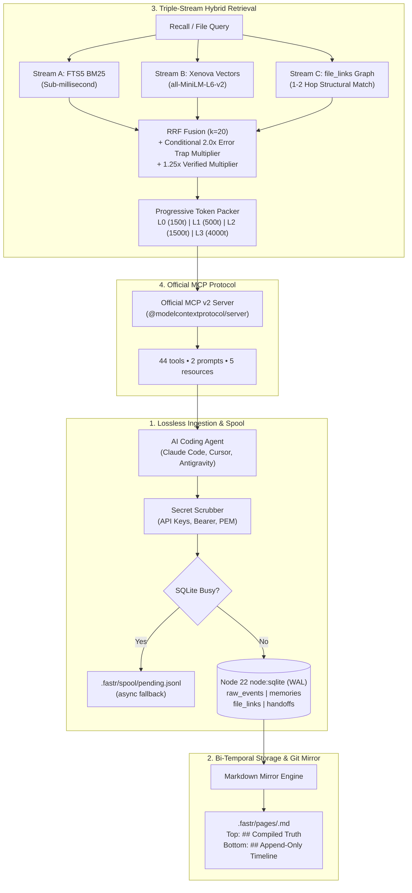

<div align="center">

# ⚡ FastrMemory

### High-Performance Cognitive Agent Memory Engine
**Zero Daemon • Native Node 22+ `node:sqlite` • Bi-Temporal Git Sync • Triple-Stream RRF • Official MCP v2**

[](https://github.com/atifjubaer/fastrmemory/actions)
[](https://www.npmjs.com/package/fastrmemory)
[](LICENSE)
[](https://nodejs.org)
[](https://modelcontextprotocol.io)
[](tests/)
[](#-one-click-agent-mcp-configuration)
[](#-architecture)

> **Status (2026-10-27):** **`fastrmemory@0.7.0` is published and is `latest`.** Evidence: `npm view fastrmemory version` -> `0.7.0`; `npm view fastrmemory dist-tags --json` -> `{"latest":"0.7.0"}`; tag `v0.7.0` (`5512557`); published 2026-10-27 via GitHub Actions OIDC with npm provenance; the release workflow passed the full gate, clean tarball install, registry verification, and GitHub Release upload; the npm tarball is 343 files, 764,560 bytes packed, 3,091,719 bytes unpacked; GitHub Release asset SHA-256 `fb9ecea9b487edb4389598b5d514c5392d900d4a806f8b85a7ed065ec73058cc`; a clean `npm install fastrmemory@0.7.0` + `fastr --version` -> `0.7.0`; `npm audit signatures` reports 5 verified registry signatures and 4 verified attestations. The official MCP registry lists `io.github.atifjubaer/fastrmemory@0.7.0` as `active` and `isLatest` (`publishedAt` `2026-10-27T04:05:39Z`). Caveat: Node.js >=22.16.0; `0.6.0`, `0.5.0`, `0.4.0`, `0.3.1`, and `0.3.0` remain published historical. This release adds the code symbol index and declaration anchoring, per-turn memory injection, read-only recall, and self-verifying memories; the schema changes are additive only (`symbols`, `file_edits`, `memories.assertion`, `file_links.symbol_id` / `declaration_id`), with no data rewrite. The old scoped npm entries (`@atifjubaer/fastrmemory` and `fastrmemory@0.0.0-stage`) were removed on 2026-10-23; the GitHub `v0.2.1` tag and release remain as history. This README tracks current `main`. Current `main` is **`0.7.0`** and has **456 tests / 67 files**. Use the exact `0.7.0` version for reproducibility. PR #20 at `5512557` passed all eight required checks (six matrix jobs plus Replayable Memory Diff and Pre-Merge Trap Guardian); the historical `0.6.0` release commit `a57a656`, `0.5.0` release commit `54a79ab`, and `0.4.0` release commit `bb365c2` remain published historical. The exact release surface is in [CHANGELOG.md](CHANGELOG.md). The headline benchmark uses **240 deterministic synthetic cases with a 20% holdout**, not SWE-bench or LongMemEval. Public LongMemEval, LoCoMo, and self-repository retrieval-only results plus pinned external baselines are in [BENCHMARKS.md](BENCHMARKS.md); no QA-leaderboard parity is claimed. Performance, packaging, and retrieval claims are tracked in [CLAIMS.md](CLAIMS.md); every README section is mapped to claim IDs in the README claim trace at the end of that ledger. Methodology, caveats, and raw JSON are in [BENCHMARKS.md](BENCHMARKS.md).

<p align="center">
  <a href="#-overview">Overview</a> &bull;
  <a href="#-design-principles">Design Principles</a> &bull;
  <a href="#-retrieval-benchmark-240-synthetic-cases">Benchmarks</a> &bull;
  <a href="#-local-web-dashboard">Web UI</a> &bull;
  <a href="#-works-with-mcp--and-http-compatible-agents">Supported Agents</a> &bull;
  <a href="#-quick-start">Quick Start</a> &bull;
  <a href="#-one-click-agent-mcp-configuration">MCP Setup</a> &bull;
  <a href="#-mcp-server-tools--resources">MCP Tools</a> &bull;
  <a href="#-architecture">Architecture</a> &bull;
  <a href="MIGRATION.md">Migration</a> &bull;
  <a href="SECURITY.md">Security</a> &bull;
  <a href="SCORECARD.md">Scorecard</a>
</p>

</div>

---

## Launch Status at a Glance

| Claim | Current result | Evidence |
|---|---|---|
| Install path | Published `fastrmemory@0.7.0` | `npm view fastrmemory version` -> `0.7.0`; `npm view fastrmemory dist-tags --json` -> `{"latest":"0.7.0"}`; `npm install fastrmemory@0.7.0`; `fastr --version` -> `0.7.0`; GitHub Release tarball SHA-256 `fb9ecea9...`; old scoped npm entries removed |
| MCP registry | `io.github.atifjubaer/fastrmemory@0.7.0`, status `active`, `isLatest` | `curl --get --data-urlencode "search=io.github.atifjubaer/fastrmemory" https://registry.modelcontextprotocol.io/v0.1/servers`; `gh run view 40262643667` |
| Synthetic retrieval (optional MiniLM) | Holdout `95.8%` Hit@1, `100%` Hit@5, MRR `0.969` | `npx tsx scripts/eval-bench.ts --split all --embeddings minilm --out bench/results/minilm.json` |
| Test suite | `456` tests across `67` files on current `main`; published `0.7.0` is `455` / `67`; published `0.6.0` is `388` / `61`; `0.5.0` is `297` / `53`; historical `0.4.0` is `293` / `53`; `0.3.1` is `282` / `52`; v0.2.1 is `235` / `43` | `npm test`; `npm run check:ci` |
| MCP setup | `fastr mcp init` merges portable registry configs or active-CLI local configs for 9 JSON clients and prints a Codex TOML snippet; `--source local` ships in published `0.7.0`, `0.6.0`, and `0.5.0` | `npm test -- tests/mcp-init.test.ts` -> `15 passed`; `fastr mcp init --client claude --source local --dry-run --json` -> `node .../dist/bin/fastr.js mcp --project ...` |
| Cross-engine (MCP stdio) | `80/120` overall Hit@1 (`66.7%`, 95% CI `57.8`-`74.5`): exact `40/40`, multi `40/40`, paraphrase `0/40`; `1.094` ms/doc ingest, `1.86` ms recall p50 | `npm run bench:vs`; `bench/results/vs-engines.json` |
| Crash safety | 10/10 runs, 0 lost, 0 duplicate ids/titles | `npm run test:crash`; `bench/results/crash-test.json` |
| Public retrieval (0.3.0) | LongMemEval `+10.4pp` / `+11.0pp` Hit@5; LoCoMo `+4.4pp` / `+2.3pp` (target missed) | [docs/EXTERNAL_BASELINE.md](docs/EXTERNAL_BASELINE.md) |
| Release score | Provisional `9.4 / 10`; `9.2` target met; Retrieval remains Partial | [SCORECARD.md](SCORECARD.md) |

The synthetic table is not SWE-bench or LongMemEval. Public numbers are retrieval-only and are not QA-leaderboard results. The `95.8%` row uses optional MiniLM; the default offline hash path scores `77.1%` Hit@1 / `93.8%` Hit@5 on the same holdout. Full provenance is in [CLAIMS.md](CLAIMS.md).

---

## 💡 Overview

AI coding agents (Claude Code, Cursor, Windsurf, Codex, Antigravity) degrade on long-running codebases when project memory is lossy or operationally heavy. Common designs make one of three trade-offs:
- **Decay and merge** old episodes to keep the store small, which can lose exact file paths, stack traces, and edge cases.
- **Run a daemon or external database**, which adds ports, containers, and setup failure modes.
- **Dump a static context file**, which grows without bound and is not queryable.

**FastrMemory** keeps a verbatim event log, bi-temporal memory history, and a replayable Git mirror in a **single in-process TypeScript engine** (3 runtime dependencies; local embeddings and the daemon are optional):

<table>
<tr>
<td width="33%" align="center">

### ⚡ Zero Daemon Overhead
Pure Node 22+ built-in `node:sqlite` in WAL mode. On the 240-case suite, engine-level recall is **0.95 ms p50 / 1.60 ms p95** with hash embeddings and **3.30 ms p50 / 5.11 ms p95** with MiniLM on the train split (CLI startup measured separately). The default CLI/MCP path has no background daemon and no open port; `daemon start` is optional. Native on Windows, macOS, and Linux (the current CI matrix uses Intel macOS; Apple Silicon is not covered); CI matrix status is reported in [Actions](https://github.com/atifjubaer/fastrmemory/actions).

</td>
<td width="33%" align="center">

### 🔀 Bi-Temporal Git Sync
Never deletes facts during consolidation (there is no destructive sleep step). Replaces half-life decay with `valid_from` / `valid_to` timestamps and auto-mirrors human-readable `.fastr/pages/*.md` files into Git.

</td>
<td width="33%" align="center">

### 🎯 Triple-Stream RRF ($k=20$)
Fuses FTS5 BM25 + optional local embeddings + file-graph links. Error traps receive a **conditional 2.0x boost** only for trap-intent or file-scoped queries, with per-ID outcome feedback (+0.2 / -0.5). Three consecutive bad outcomes move a memory to dormant; confidence tiers are `high`, `medium`, `low`, `dormant`, and `superseded`. Counting questions ("how many projects have I led?") additionally run an aggregate-coverage pass: a second lexical query over their content terms, fused with the original, returning up to 20 rows so the caller can count. `retrieval.temporalFilter` adds opt-in date windows ("past two weeks", "this year") parsed against the question date.

</td>
</tr>
</table>

---

## 🧭 Design Principles

| Principle | Implementation |
| :--- | :--- |
| **Lossless by default** | Raw events, bi-temporal `valid_from` / `valid_to`, and supersession chains are retained. Nothing is destroyed by consolidation. |
| **Zero daemon by default** | One Node 22+ process uses built-in `node:sqlite` in WAL mode. The default CLI/MCP path opens no ports or background services; `daemon start` is optional. |
| **Replayable** | Git-diffable Markdown mirrors plus snapshots and rollback keep history inspectable. |
| **Measured, not asserted** | Public claims are tied to committed benchmark JSON with a 20% holdout; simulated baselines are labeled as simulations. |

---

---

## 🤖 Works With MCP- and HTTP-Compatible Agents

FastrMemory exposes one stdio MCP server and optional local HTTP services (dashboard and daemon). **Native installers wire Claude Code (MCP config plus lifecycle hooks), Cursor (MCP config plus skills), and, since 0.3.0, Gemini CLI, GitHub Copilot CLI, and OpenCode V2** (`fastrmemory hook install`); `fastrmemory setup` also writes MCP configs for Antigravity, Claude Desktop, and Windsurf. Every other client connects through its own MCP configuration or the REST API. Integration depth varies by client - only the native installers are covered by tests in this repository.

Clients commonly used with FastrMemory include Codex CLI, Gemini CLI, OpenCode, GitHub Copilot CLI, Antigravity, Claude Desktop, Cline, Continue, Roo Code, Goose, Zed, Warp, and Aider. Listing a client does **not** imply a tested native integration.

---

## 🚀 Quick Start

### ⚡ Run Without a Global Install

The canonical package target is unscoped `fastrmemory@0.5.0`. `0.4.0` and `0.3.1` remain published historical. The old scoped npm entries were removed on 2026-10-23.

```bash
# Canonical one-shot (pins the exact release):
npx -y fastrmemory@0.5.0 setup

# Or launch the local Web UI:
npx -y fastrmemory@0.5.0 ui
```

The GitHub source path remains available for development only: `npx github:atifjubaer/fastrmemory setup`. For a reproducible source install, pin the tag: `npx github:atifjubaer/fastrmemory#v0.5.0 setup`. Do not use either GitHub form in generated MCP or hook configs; those must use the npm package. The default `latest` channel tracks new releases, and `--channel pinned` records the exact version for reproducibility.

---

### Install from npm

```bash
# Canonical install (latest is 0.7.0):
npm install -g fastrmemory
fastr --version

# Exact release:
npm install -g fastrmemory@0.7.0
```

For a one-shot run without a global install:

```bash
npx -y fastrmemory@0.7.0 --version
```

The official MCP registry lists the server as `io.github.atifjubaer/fastrmemory` (`0.7.0`, status `active`), so registry-aware clients can find it by name; the entry carries the same `npx -y fastrmemory@0.7.0 mcp` package and stdio transport. `0.7.0` is built from tag `v0.7.0` by `.github/workflows/release.yml`, which runs the full gate, publishes with npm provenance, and attaches the same tarball to the GitHub Release. Verify the registry result with `npm view fastrmemory@0.7.0 version` and `npm view fastrmemory dist-tags --json`; a first E404 for a few minutes is registry propagation, not a failed publish. The old scoped npm entries remain removed. Do not republish `0.3.0`. `0.5.0`, `0.4.0`, and `0.3.1` remain published historical.

### Update an Existing Install

Stop every agent, hook, `fastr ui`, and `fastr daemon` before changing versions. Run this from the project root:

```bash
# 1. Back up memory before changing versions
fastr backup fastr-backup.jsonl
fastr backup --verify fastr-backup.jsonl

# 2. Update the global CLI
npm install -g fastrmemory@latest
fastr --version

# 3. Refresh project integration (choose what you use)
fastr mcp init --client all --scope project   # portable npx configs only
fastr mcp init --client all --scope user --source local --profile core  # installed CLI
fastr setup                                   # MCP configs, AGENTS.md, and skills
fastr hook install                            # lifecycle hooks plus MCP for hook clients

# 4. Verify
fastr status
fastr hygiene
```

`0.5.0` has no schema migration. If you use `--channel pinned`, rerun `fastr mcp init` after each update; with the default `latest` channel, restart the client to pick up the new release. If you use `--source local`, the config points at the installed CLI, so updating the global package updates the server without rewriting the config. `fastr setup` refreshes copied skills, overwrites same-named skill files, removes retired skills, and leaves user-owned directories. `fastr hook install` does not copy skills. See [MIGRATION.md](MIGRATION.md) for rollback.

### One-Command MCP Setup

`fastr mcp init` is the shadcn-style setup path. It is config-only: it merges the `fastrmemory` MCP entry into an existing client config, preserves unrelated keys, writes a one-time `.fastr.bak` backup, and is idempotent. It does not install lifecycle hooks, skills, or the OpenCode plugin; use `fastr hook install` for hooks and the OpenCode plugin, and `fastr setup` for skills.

```bash
# Claude Code (project-scoped .mcp.json)
npx -y fastrmemory@latest mcp init --client claude

# Cursor
npx -y fastrmemory@latest mcp init --client cursor

# VS Code (.vscode/mcp.json)
npx -y fastrmemory@latest mcp init --client vscode

# OpenCode (opencode.json)
npx -y fastrmemory@latest mcp init --client opencode

# Gemini CLI and GitHub Copilot CLI
npx -y fastrmemory@latest mcp init --client gemini,copilot

# Every project-scoped client at once
npx -y fastrmemory@latest mcp init --client all --scope project
```

The same command through the other package runners:

```bash
pnpm dlx fastrmemory@latest mcp init --client claude
yarn dlx fastrmemory@latest mcp init --client claude
bunx fastrmemory@latest mcp init --client claude
```

The default `--channel latest` writes `fastrmemory@latest`, so a client restart picks up the newest npm release. Use `--channel pinned` for a reproducible config containing the exact version that ran the command; on current `main` that writes `fastrmemory@0.5.0`. `--runner pnpm|yarn|bunx` changes the generated runner, `--profile full` selects the 43-tool surface (the default is the 12-tool core profile), `--dry-run` prints targets without writing, and `--scope user` writes user-level configs with an explicit `--project /absolute/path` so the server always opens the intended database. Codex prints a `[mcp_servers.fastrmemory]` TOML block for `~/.codex/config.toml` instead of rewriting a user-owned TOML file.

For a globally installed CLI, use `--source local` to write the active CLI path instead of an npx command. It always appends an absolute `--project`, so the config is machine-specific but starts without an npx cold start:

```bash
fastr mcp init --client all --scope user --source local --profile core
```

Updating the global package updates the server; rerun the command only if the CLI path changes. Use the default `--source registry` for portable project configs that are committed and shared across machines.

> `--source local` ships in published `0.5.0`; `0.4.0` remains published historical. On `0.4.0`, use `fastr setup` for an installed-CLI config.

> `mcp init` ships in `0.4.0` and later; `npx fastrmemory@latest mcp init ...` now resolves to published `0.5.0`. If you need the previous release, use `fastr setup` or pin `fastrmemory@0.3.1`.

### Install from GitHub

For a one-shot source run, pin the release tag:

```bash
npx --yes github:atifjubaer/fastrmemory#v0.5.0 --version
npx --yes github:atifjubaer/fastrmemory#v0.5.0 setup
```

For a global CLI without npm's Git resolver, download the release tarball:

```bash
curl -L -o fastrmemory-0.5.0.tgz \
  https://github.com/atifjubaer/fastrmemory/releases/download/v0.5.0/fastrmemory-0.5.0.tgz
npm install -g ./fastrmemory-0.5.0.tgz
fastr --version
```

On Windows, download the same URL with `Invoke-WebRequest` or a browser, then run `npm install -g .\fastrmemory-0.5.0.tgz`. For a local project install, use `npm install --no-save ./fastrmemory-0.5.0.tgz` instead of the global flag.

> Git installs build from source and are slower than the npm tarball; for a global CLI, prefer the npm package or the release tarball above. `npm install -g git+https://...` is not recommended with npm 11 because the `prepare` build does not receive dev dependencies. Both `fastrmemory` and `fastr` (short alias) are executable after installation. The canonical package is unscoped `fastrmemory@0.5.0`; the old scoped npm entries are gone. Use npm for generated MCP and hook configs so installs stay reproducible.

### 2. Verify Database Health

```bash
fastrmemory status
```

Output:
```text
=== FastrMemory Health (my-project) ===
- Project ID:          proj_1cce2a654e3a
- Active Memories:     2
- Staging Memories:    0
- Superseded History:  0
- Ingested Events:     0
- Pending Spool:       Clear (0)
- Database File:       .fastr/fastr.db
```

### 3. Record & Recall a Memory

```bash
# Record an error trap linked to an exact file:
fastrmemory remember "Never Use Date.now() Milliseconds for JWT Expiration" \
  -c "JWT exp claims expect integer seconds. Always use Math.floor(Date.now() / 1000)." \
  -m auth -k error_trap -f "src/auth/jwt.ts" --verified

# Recall with conditional 2.0x trap boost & file-graph matching:
fastrmemory recall "JWT expiration" -f "src/auth/jwt.ts"
```

Output:
```text
=== Recalled Memories (1 results, ~46 tokens) ===

[mem_009e4a7d] [TRAP] [verified] Never Use Date.now() Milliseconds for JWT Expiration (Score: 0.08)
JWT exp claims expect integer seconds. Always use Math.floor(Date.now() / 1000).
```

Open contradictions are marked on both sides of the recall result instead of being silently mixed into context (**0.3.0**):

```bash
# Inspect unresolved contradictions:
fastrmemory conflict list

# Keep the rule that matches the project and supersede the loser:
fastrmemory conflict resolve 1 --keep mem_009e4a7d --forget --reason "Seconds are the project standard"
```

#### Import Existing Local Rules (**0.3.0**)

Bring `AGENTS.md`, `CLAUDE.md`, or `.cursor/rules/*.mdc` content into memory without hand-copying every section. Level 2+ headings become memories; bullet lists and paragraphs are fallbacks. Re-importing the same file skips exact duplicates.

```bash
# Preview the parsed sections without writing:
fastrmemory import AGENTS.md --from agents-md --module rules --dry-run

# Import as staging memories for review, or verify them immediately:
fastrmemory import AGENTS.md --from agents-md --module rules
fastrmemory import AGENTS.md --from agents-md --module rules --verified

# JSONL snapshots use the same entry point:
fastrmemory import snapshot.jsonl --from jsonl
```

### 4. Cognitive Git Blame & Memory-Aware Commit

```bash
# Cognitive Git Blame linking lines directly to commit, author, and governing error traps (conditional 2.0x boost):
fastrmemory blame src/auth/jwt.ts:42

# Pre-commit error trap validation & conventional commit synthesis:
fastrmemory commit
```

### 5. Git Snapshots, Branches, Rollback & Background Daemon (branches are **0.3.0**)

```bash
# Point-in-time memory snapshot (Git for Agent Memory):
fastrmemory snapshot create "pre-refactor-checkpoint"
fastrmemory snapshot list
fastrmemory snapshot rollback "pre-refactor-checkpoint"

# 0.3.0: Portable backup with a sidecar provenance manifest:
fastrmemory backup backups/pre-upgrade.jsonl
fastrmemory backup --verify backups/pre-upgrade.jsonl
fastrmemory backup --restore backups/pre-upgrade.jsonl --dry-run

# Immutable memory branch and one-way merge with a conflict report:
fastrmemory branch create feature/auth
fastrmemory branch list
fastrmemory merge feature/auth
fastrmemory merge feature/auth --force --strategy branch

# Hybrid Background Daemon (Optional HTTP/SSE service for cross-process tools):
fastrmemory daemon start
fastrmemory daemon status
fastrmemory daemon stop

# Auto-wire MCP + lifecycle hooks for Claude Code, Cursor, Gemini CLI, Copilot CLI, and OpenCode:
fastrmemory hook install

# Auto-wire MCP + AGENTS.md + Planetary Skills; setup also wires Antigravity, Claude Desktop, and Windsurf:
fastrmemory setup

# Mine past Git bug fixes directly into staging error traps:
fastrmemory learn -n 30 --days 90
```

Branches are immutable snapshot pointers. `merge` is one-way into the current active set: branch-only memories are added, target-only memories are preserved, and same-identity changes are reported as conflicts. Conflicts block writes by default; `--force` applies non-conflicting additions, and `--force --strategy branch` supersedes the target while keeping old rows in history. Branch checkout or a mutable branch working tree is not implemented.

`backup` writes the portable JSONL snapshot plus `<file>.manifest.json` with the file SHA-256, content hash, record counts, tool version, environment, and source integrity. `--restore` verifies both hashes before importing; `--dry-run` reports counts without writing. The backup scope is memories, raw events, file links, and conflicts, not a physical SQLite/WAL copy. See [MIGRATION.md](MIGRATION.md) for the full backup and rollback path.

### 6. Token Compression, Database Doctor & Vision Search

```bash
# Compress markdown docs & LLM prompt context to reduce token usage:
fastrmemory compress docs/architecture.md --dry-run

# Run deep health check across SQLite, FTS5 indices, file links, and task DAGs:
fastrmemory diagnose

# Auto-repair FTS5 indices, orphaned file links, and WAL fragmentation:
fastrmemory heal

# 0.3.0: Report orphaned records, duplicate active memories, and stale rows:
fastrmemory hygiene
fastrmemory hygiene --stale-days 30 --json --fail-on-issues

# Tag a UI screenshot or architecture diagram with OCR & 384-dim vector indexing:
fastrmemory vision tag screenshots/modal-error.png --desc "Modal error 401 alert" --ocr "HTTP 401"

# Semantic search across tagged screenshots and visual diagrams:
fastrmemory vision search "modal error 401"

# Pre-merge CI/CD gate checking PR diffs against active error traps:
fastrmemory guard --strict

# Optional 30 MB static semantic model (never downloaded implicitly):
fastrmemory model status
fastrmemory model install
```

`fastrmemory hygiene` reports orphaned file links, conflict rows, and feedback rows; duplicate active memories by normalized title or exact content; and stale unpinned active memories (default 90 days since the last recall or creation). `npm run check:hygiene` runs the same inspector against a deterministic fixture inside `check:ci`; it does not mutate a project database. Use `--fail-on-issues` when a script should exit nonzero on findings.

`fastrmemory model install` fetches `minishlab/potion-base-8M` (256-dim, 30,236,760 bytes), verifies both files against pinned SHA-256 hashes, and stores them under `~/.fastr/models/`. The tier is a bounded reranker over BM25 candidates: it fixes 1 case and breaks 1 across the 120-case LongMemEval slice, so it is documented as non-regressive, not as an accuracy win. Default recall is BM25-only until the asset is installed and backfill has produced vectors.

---

## 🔌 One-Click Agent MCP Configuration

`fastr mcp init` is the one-command path for MCP-only wiring. By default it uses `--source registry` and writes the platform-correct portable runner (`npx`, `pnpm dlx`, `yarn dlx`, or `bunx`; `cmd /c ...` on native Windows). Pass `--source local` to write the active CLI path plus an absolute `--project`, which is useful for a globally installed CLI but makes the config machine-specific. It preserves unrelated config keys and is idempotent. `fastr setup` remains the full installer for `.fastr/`, `AGENTS.md`, MCP configs, and skills; `fastr hook install` adds lifecycle hooks plus MCP configs for Claude Code, Cursor, Gemini CLI, Copilot CLI, and OpenCode.

`fastr hook install` merges lifecycle hooks for Claude Code, Cursor, Gemini CLI, GitHub Copilot CLI, and OpenCode, and writes the OpenCode context/compaction plugin. `fastr hook uninstall` removes exactly what install wrote — the `fastrmemory` MCP entry, the hook commands, the managed OpenCode plugin, and the `AGENTS.md` discipline block — while leaving every user entry in the same files untouched. Both commands are idempotent, accept `--client <ids|all>`, `--project <dir>`, `--no-agents-md`, and `--json`, and are covered by [docs/CLIENT_SUPPORT.md](docs/CLIENT_SUPPORT.md). Gemini CLI requires strict JSON on hook stdout; Copilot returns `permissionDecision: "ask"` for an active trap because it has no model-facing advisory field for `preToolUse`.

| Client | Project config | User config | JSON key |
| :--- | :--- | :--- | :--- |
| Claude Code | `.mcp.json` | `~/.claude.json` | `mcpServers` |
| Cursor | `.cursor/mcp.json` | `~/.cursor/mcp.json` | `mcpServers` |
| VS Code | `.vscode/mcp.json` | VS Code `User/mcp.json` | `servers` |
| OpenCode | `opencode.json` | project only | `mcp.servers` |
| Gemini CLI | `.gemini/settings.json` | `~/.gemini/settings.json` | `mcpServers` |
| GitHub Copilot CLI | `.github/mcp.json` | project only | `mcpServers` |
| Windsurf | user only | `~/.codeium/windsurf/mcp_config.json` | `mcpServers` |
| Antigravity | user only | `~/.gemini/antigravity/mcp_config.json` | `mcpServers` |
| Claude Desktop | user only | platform-specific | `mcpServers` |
| Codex | user only | `~/.codex/config.toml` | printed TOML |

Example POSIX project config generated by `fastr mcp init --client cursor` (Windows uses `cmd /c npx ...`):

```json
{
  "mcpServers": {
    "fastrmemory": {
      "command": "npx",
      "args": ["-y", "fastrmemory@latest", "mcp"]
    }
  }
}
```

VS Code uses `servers` instead of `mcpServers`; OpenCode uses `mcp.servers` with a command array and `"type": "local"`. Existing `opencode.json(c)` settings are preserved, but a JSONC config is reported for manual wiring rather than rewritten. Codex is always printed as a `[mcp_servers.fastrmemory]` TOML block because rewriting a user-owned TOML file safely requires a dedicated parser.

For user-scoped clients, the generated entry includes `--project /absolute/path/to/repo`; this prevents the client's launch directory from selecting the wrong database. `fastr setup` also writes the absolute `node` path and is the recommended path when the client cannot launch package-runner shims. `--source local` is the `mcp init` equivalent for an installed CLI: it writes the active CLI path and an absolute `--project`; use `--source registry` (the default) when the config will be committed or shared. `--source local` ships in published `0.5.0`; on `0.4.0`, use `fastr setup` for an installed-CLI config. On native Windows, `fastr mcp init` automatically emits `"command": "cmd"` with `"/c"` and the runner, so manual `npx.cmd` fixes are not needed.

`--client all --scope project` covers the six project-scoped clients in the table. `--client all --scope user` covers the eight user-scoped clients; OpenCode and Copilot CLI are project-only, while Codex prints a TOML block for manual insertion. User-scoped entries pin one `--project` database, so use project scope when each developer may open a different checkout.

---

## 🛠️ MCP Server: Tools & Resources

Built using the official **v2 `@modelcontextprotocol/server`** SDK. The tool list below describes **0.5.0** (tool surface unchanged from 0.4.0); the v0.2.1 release has 4 resources.

### 44 MCP Tools

The default **core profile** exposes 12 tools: the daily loop (`fastr_recall`, `fastr_remember`, `fastr_handoff`, `fastr_trap_recall`, `fastr_trap_log`, `fastr_status`, `fastr_get`, `fastr_replay`, `fastr_compress`, `fastr_diagnose`) plus `fastr_tools` for discovery and `fastr_call` for dispatch. Its `tools/list` payload is 8,715 bytes (~2,179 tokens). The **full profile** exposes all 44 tools; start it with `fastrmemory mcp --profile full` or `FASTR_MCP_PROFILE=full`. Every full-profile tool stays reachable from the core profile through `fastr_call`. Resources and prompts are the same in both profiles. Pass `--project /absolute/path/to/repo` when the host starts the server outside the repository, so memory is written to the intended `.fastr/fastr.db`.

#### Cognitive Retrieval & Memory Core
1. `fastr_recall`: Triple-stream hybrid search (BM25 + Vector + Spreading Activation Graph) with progressive L0–L3 token budgeting and air-gapped offline vector fallback.
2. `fastr_get`: Retrieves complete memory details (including status, timestamps, reward scores, and full content) by memory ID.
3. `fastr_list`: Lists memories with bounded filtering by module, kind, status, limit, and offset.
4. `fastr_drill`: Resolves `source_event_ids` to retrieve untruncated verbatim stack traces, diffs, and tool outputs from `raw_events`.
5. `fastr_file_history`: Returns active rules, `[TRAP]` warnings, and past supersessions for a specific file path.
6. `fastr_symbol_history`: Returns active rules, [TRAP] warnings, and past supersessions anchored to a named function, class, or type. The anchor follows the declaration through a rename or a file move, so a trap written against `signToken` is still found after it becomes `signJwt`.
7. `fastr_remember`: Records new rules, decisions, or traps. Automatically extracts NER entities, scrubs secrets, and re-renders Markdown mirrors. Supports `scope: 'project' | 'global'`.
8. `fastr_pin`: Pins critical rules so they are permanently preserved and prioritized in L0 assembly without time decay.
9. `fastr_forget`: Tombstones and deactivates an outdated memory cleanly with audit logging.
10. `fastr_supersede`: Retires an outdated rule (`valid_to = now`), records the rationale, and inserts a replacement verified rule.
11. `fastr_feedback`: Updates `reward_score` and the confidence tier on one memory ID (+0.2 good, -0.5 bad). Three consecutive bad outcomes make it dormant; never penalizes innocent memories.
12. `fastr_handoff`: Saves or retrieves cross-agent session milestones and promotes staging memories to verified.
13. `fastr_status`: Returns active/staging counts, spool health, and embedding coverage %.
14. `fastr_graph_query`: Explores 1-hop and 2-hop structural file-link dependencies, entity links, and connected error traps.
15. `fastr_timeline`: Chronological audit trail of memory events, newly verified rules, error traps, and historical supersessions.

#### Versioning & Error Traps
16. `fastr_snapshot`: Creates named point-in-time memory snapshots for branch tracking and experiment safety.
17. `fastr_rollback`: Instant Git-like rollback to any previous memory snapshot.
18. `fastr_trap_log`: One-line rapid logging of error traps and bug solutions with a conditional 2.0x recall boost.
19. `fastr_trap_recall`: Targeted lookup of high-priority error traps protecting specific target files before editing.

#### Proactive Contradiction Detection & Resolution
20. `fastr_conflicts`: Proactive contradiction detection using Jaccard token overlap (minimum 0.35) and 50-word opposing-polarity analysis.
21. `fastr_resolve`: Resolves contradictions by keeping preferred rule and superseding or weakening the loser.

#### Kahneman Planning Fallacy & Base-Rate Calibrator
22. `fastr_predict`: Records effort/time/risk predictions and closes predictions with actual empirical outcomes.
23. `fastr_predict_baserate`: Computes historical reference-class statistics (Mean, Median p50 ratio, MAE) to debias agent estimates.

#### Multi-Agent Action DAG & Frontier
24. `fastr_action_create`: Creates structured work item actions with prerequisite (`requires`) and conflict (`conflicts_with`) constraints.
25. `fastr_action_update`: Updates task lifecycle (`pending`, `active`, `done`, `blocked`), assignments, and memory crystallization.
26. `fastr_frontier`: Computes unblocked, ready-to-execute frontier actions with satisfied dependencies.
27. `fastr_next`: Atomically claims and returns the highest-priority frontier action for autonomous worker agents.

#### Bounded Working Memory & Obsidian Vault Export
28. `fastr_slot_get`: Retrieves bounded working memory slot (e.g. `current_goal`, `user_preferences`, `active_hypothesis`).
29. `fastr_slot_set`: Updates working memory slot with hard character ceiling enforcement to prevent context bloat.
30. `fastr_slot_list`: Lists all working memory slots and active character usage.
31. `fastr_obsidian_export`: Exports all memories, entities, and relationships into an Obsidian-compatible markdown vault with YAML frontmatter, `[[wikilinks]]`, and `MOC.md`.

#### Multi-Repository Federation & Context Assembly
32. `fastr_federate`: Manages cross-repository organization-wide shared rules and error traps via SQLite native `ATTACH DATABASE` (`~/.fastr/global.db`).
33. `fastr_assemble`: Dynamically formats and packs high-density structured prompt context (`<fastr_context>`) with token budgeting.
34. `fastr_risk_predict`: Computes historical failure probability and active trap hazard score for target codebase files.
35. `fastr_verify_provenance`: Cryptographically verifies SHA-256 provenance hashes for recorded agent attribution.

#### Token Compression & Autonomous Doctor
36. `fastr_compress`: Compresses markdown files or prompt context while strictly preserving headings, URLs, and code blocks with `.original.md` backup.
37. `fastr_diagnose`: Deep health audit of SQLite B-Tree integrity, FTS5 BM25 search indices, orphaned file links, and task DAGs.
38. `fastr_heal`: Automatic repair of database indices, dangling edges, and WAL page reclamation.

#### Memory Replay & Diff
39. `fastr_replay`: Reconstructs memory state at a timestamp and returns the active snapshot for audit or recovery.
40. `fastr_diff`: Compares two snapshots and reports added, superseded, and removed memories.

#### Multimodal Visual Memory
41. `fastr_vision_tag`: Tags screenshots, UI diagrams, and wireframes with OCR and semantic descriptions with 384-dim embeddings.
42. `fastr_vision_search`: Hybrid vector and keyword search across stored visual assets for multimodal coding agents.

#### Tool Discovery & Dispatch
43. `fastr_tools`: Lists every tool the server can run, with its JSON input schema, filtered by name or description. Part of the core profile.
44. `fastr_call`: Runs any tool from `fastr_tools` by name after validating arguments against that tool's schema. Part of the core profile.

### 2 MCP Prompt Templates

- `pre-edit-check`: Given file paths, instructs the agent to check traps and relevant rules before editing.
- `session-wrap-up`: End-of-session checklist for logging traps, superseding stale rules, scoring memories, and saving a handoff.

### 5 MCP Resources (0.3.0; v0.2.1 has 4)

- `fastr://project/overview`: L0 project summary containing active counts and storage location.
- `fastr://project/traps`: All active `[TRAP]` warnings for immediate bug avoidance.
- `fastr://session/handoff`: Latest cross-agent handoff milestone.
- `fastr://memory/{id}` (resource template): Full JSON for a single memory, including linked files and its validity window.
- `fastr://memory/{id}/envelope` (resource template): Metadata, cryptographic provenance, file/graph links, and open/resolved conflict state for one memory.

---

## 📄 Two-Zone Git-Diffable Mirror

Every write to the local SQLite database automatically synchronizes human-readable markdown files in `.fastr/pages/<module>.md`. This allows developers to review AI memories directly in GitHub Pull Requests:

```markdown
# Module: auth

> Auto-generated by FastrMemory. Active rules are at the top; superseded history is preserved below for Git diffs.

---

## Compiled Truth (Active Rules & Traps)

### [mem_009e4a7d] [TRAP] Never Use Date.now() Milliseconds for JWT Expiration
- **Kind**: `error_trap`
- **Status**: `verified` (Reward Score: 1)
- **Linked Files**: `src/auth/jwt.ts`
- **Active Since**: `2026-10-18T21:46:20Z`

JWT exp claims expect integer seconds. Always use Math.floor(Date.now() / 1000).

---

## Append-Only Timeline (History & Superseded)

### [EXPIRED 2026-10-18T20:00:00Z -> 2026-10-18T21:46:20Z] [mem_abc123] Token Signing
- **Superseded By**: `[mem_009e4a7d]`
- **Reason**: Standardized on integer seconds
- **Historical Status**: `superseded`

> Old implementation used milliseconds which failed expiration validation.
```

---

## 🧠 Planetary Agent Skills Suite

FastrMemory ships 10 Agent Skills (in `skills/`, mirrored to `.cursor/skills/`) that tell agents *when* to use each memory tool. Install them as a Claude Code plugin (`.claude-plugin/`) or copy them with `fastrmemory setup`:

- [fastr-memory](skills/fastr-memory/SKILL.md): At the start of a task and before editing files: `fastr_trap_recall`, then `fastr_recall` / `fastr_assemble`.
- [fastr-trap-log](skills/fastr-trap-log/SKILL.md): The moment a failure is diagnosed: record it with `fastr_trap_log`.
- [fastr-session-commit](skills/fastr-session-commit/SKILL.md): When a task is done and tests pass: supersede, rate memories, and `fastr_handoff` with `verifyStaging`.
- [fastr-curate](skills/fastr-curate/SKILL.md): When storing durable lessons or fixing contradictions: dedupe, remember, supersede, resolve conflicts, snapshot/rollback.
- [fastr-setup](skills/fastr-setup/SKILL.md): When FastrMemory is not wired into Claude Code: `fastrmemory hook install`, `claude mcp add`, verify with `fastrmemory status`.
- [fastr-plan-estimate](skills/fastr-plan-estimate/SKILL.md): When estimating effort or risk: base rates, file risk, and closing predictions.
- [fastr-dag](skills/fastr-dag/SKILL.md): When work has dependent steps or several agents share a backlog.
- [fastr-doctor](skills/fastr-doctor/SKILL.md): When recall misses memories or the database looks unhealthy: diagnose, then heal.
- [fastr-compress](skills/fastr-compress/SKILL.md): When a doc or context block exceeds its token budget.
- [fastr-vision](skills/fastr-vision/SKILL.md): When screenshots or diagrams should be remembered or searched.

Run `npm run check:skills` to validate every tool call in the skills against `src/mcp/server.ts`.

After updating the CLI, re-run `fastr setup` to refresh the copied skills. The installer overwrites same-named skill files, removes retired skills, and leaves unrelated user-owned directories. `fastr hook install` does not copy skills. Restart the client after setup. If you install the Claude Code plugin instead, update the plugin rather than maintaining a second copied skill set.

---

## 🏗️ Architecture



---

## 🧪 Testing & Verification

Run the comprehensive unit test suite:

```bash
npm test
```

All **456 tests pass** across **67 test files** on current `main`; published `0.7.0` carries **455 / 67**, and `0.6.0` has **388 / 61**, `0.5.0` has **297 tests / 53 files**, historical `0.4.0` has **293 tests / 53 files**, `0.3.1` has **282 / 52**, and v0.2.1 has **235 / 43**. Coverage includes database schema, WAL locking, offline spooling, bi-temporal supersession, secret scrubbing, two-zone rendering, automated benchmarks, snapshots/rollback, branch merge conflict reports, replay/diff, memory envelopes, confidence tiers and 3-bad dormancy, memory hygiene checks, Memory CI, conflict-aware recall, portable backup manifests and verified restore, local rule import, OpenCode V2, Gemini CLI, and Copilot CLI wiring, git-learner, cognitive blame, commit synthesis, hybrid background daemon, token compression, self-healing doctor, multimodal vision, web dashboard server, pre-merge trap guardian, symbol indexing and declaration anchoring, per-turn injection, read-only recall, self-verifying memories, UI loopback security boundaries, atomic installer configuration safety, and shadcn-style `mcp init` client config merges, including local-source entries.

**CI performance gates:** `check:query-plans`, `check:recall-latency`, and `check:install-size` run inside `check:ci`. CI executes them on the canonical Ubuntu/Node 24 job; other matrix jobs set `FASTR_PERF_GATE=0` because timing is runner-sensitive, while functional tests still run on every matrix entry.

**Clean-machine install evidence:** `npm run smoke:npx` downloads the published package with `npx` from an empty directory (no checkout, no global install, no `node_modules`), then runs `--version` and `status`. `status` opens a real `node:sqlite` database, so a package that ships without a working SQLite path fails there rather than in an editor. The script retries a registry 404 for up to ten minutes, and `.github/workflows/npx-smoke.yml` runs it on Ubuntu, Windows, and Intel macOS for Node 22.x and 24.x. CI run `40261934471` at `b9645ef` passed all six jobs, and every job reported `"version":"0.6.0"`, `"statusBooted":true`, `"attempts":1`, and `"ok":true` on a cold `npx` install; the same script passes locally on Windows / Node 24.15.0.

**Crash-safety evidence:** `npm run test:crash` kills the writer at randomized points across 10 runs, then reopens the WAL database. The committed report at [`bench/results/crash-test.json`](bench/results/crash-test.json) records **10,718 acknowledged writes**, **10,727 committed rows**, **0 lost**, **0 duplicate ids/titles**, and `PRAGMA integrity_check = ok`; methodology is in [`docs/audit/2026-10-21-crash-test.md`](docs/audit/2026-10-21-crash-test.md). `npm run check:crash` validates the report during `check:ci`. This is a process-crash test (`taskkill /F`), not a power-loss test; SQLite runs with `synchronous=NORMAL` in WAL mode.

---

## Retrieval Benchmark (240 synthetic cases)

Generated from [`bench/results/minilm.json`](bench/results/minilm.json) on **2026-10-20** at benchmark commit `562f461`. The corpus is deterministic: 120 memories and 240 queries, split into **192 train / 48 holdout (20%)**. The holdout was fixed before tuning and is reported separately. Reproduce with:

```bash
npx tsx scripts/eval-bench.ts --split all --embeddings minilm --out bench/results/minilm.json
npx tsx scripts/eval-bench.ts --split all --embeddings hash   --out bench/results/hash.json
```

| Configuration | Split | Cases | Hit@1 | Hit@3 | Hit@5 | MRR | nDCG@10 | Context tokens | p50 |
| :--- | :--- | ---: | ---: | ---: | ---: | ---: | ---: | ---: | ---: |
| FastrMemory + MiniLM | Train | 192 | 96.4% | 99.0% | 100% | 0.976 | 0.982 | 208 | 3.30 ms |
| FastrMemory + MiniLM | **Holdout** | 48 | **95.8%** | **97.9%** | **100%** | **0.969** | **0.977** | 209 | 3.41 ms |
| FastrMemory BM25-only | Train | 192 | 79.7% | 90.6% | 100% | 0.868 | 0.900 | 203 | 0.48 ms |
| FastrMemory BM25-only | Holdout | 48 | 77.1% | 77.1% | 93.8% | 0.804 | 0.835 | 204 | 0.60 ms |
| Static dump - simulated baseline | Train | 192 | 2.1% | 6.3% | 8.3% | 0.055 | 0.081 | 3652 | 0.00 ms |
| Static dump - simulated baseline | Holdout | 48 | 0.0% | 0.0% | 8.3% | 0.025 | 0.056 | 3652 | 0.00 ms |

> **Caveats:** this is a deterministic synthetic corpus, not SWE-bench or LongMemEval. The static-dump row is a simulation implemented in this repository, not an external project. Separate public retrieval-only external baselines are documented in [docs/EXTERNAL_BASELINE.md](docs/EXTERNAL_BASELINE.md); the synthetic table does not measure them. Context tokens are the compact prompt text under a 250-token budget; the ranked result objects retain full memory content. Methodology, per-category breakdowns, ablations, and confidence intervals are in [BENCHMARKS.md](BENCHMARKS.md) and [docs/benchmark-report.md](docs/benchmark-report.md).

## 🖥️ Local Web Dashboard v2 & 3D Brain Observatory

Visualize active rules, error traps, timeline audits, and interactive 3D memory constellations directly in your browser from bundled UI assets (no external service or database):

```bash
fastrmemory ui
```

- **Live URL**: `http://localhost:4242`
- **Dashboard v2 Architecture**: Built with **shadcn/ui**, **Tailwind CSS v4**, and **TanStack Query**, with SSE updates plus version polling for cross-process writes.
- **12 Focused Route Workspaces (0.3.0 adds `/replay`)**:
  - `/`: Real-time system vitals, active trap alerts, recent memory feed, and quick-action shortcuts.
  - `/memories`: Search, filter, and inspect memories with the slide-out **Memory Detail Sheet**, status toggles, pin, and 1-click forget.
  - `/traps`: Dedicated **Error Trap Quarantine** displaying governing files, conditional boost conditions, and verified mitigation lessons.
  - `/conflicts`: Proactive bi-temporal contradiction detection with side-by-side **Word Diff** and 1-click resolution (`Keep A`, `Keep B`, `Keep Both`).
  - `/actions`: Real-time interactive **Action DAG Canvas** tracking task dependencies, worker assignments, and glowing unblocked frontier aura.
  - `/graph`: Interactive file and entity relationship graph with 1-hop/2-hop inspection and memory drill-down.
  - `/observatory`: High-performance **Three.js 3D Constellation Galaxy** with a smooth lerp camera, celestial star dust, glowing amber trap halos, and memory inspect modals.
  - `/treemap`: Interactive high-DPI squarified treemap visualising memory strength bands and module density.
  - `/search`: **Search Lab** evaluating triple-stream RRF retrieval with latency waterfall breakdown (BM25 vs Vector vs Graph).
  - `/replay` (**0.3.0**): **Replay & Diff** workspace reconstructing the active set at two timestamps with snapshot metrics and added/superseded/changed/conflict review.
  - `/health`: Autonomous SQLite self-healing Doctor with 1-click integrity diagnosis, FTS5 rebuild, and vacuum.
  - `/settings`: Live database path, project configuration, and export controls.
- **Memory CI**: The PR diff workflow and comment lifecycle are documented in [docs/MEMORY_CI.md](docs/MEMORY_CI.md).
- **Dual Theme Support**: Light, dark, and system-preference modes.
- **Default Zero-Daemon Path**: The dashboard is served by the in-process Node.js HTTP server and embedded SQLite WAL mode; `fastrmemory daemon start` is an optional local REST/SSE service.

---

## 🧩 Native VS Code & Cursor Extension

Package and install the native FastrMemory Guardian extension for **VS Code** and **Cursor**:

```bash
# Compile and package extension
npm run build:extension
npx @vscode/vsce package --no-dependencies

# Install into Cursor or VS Code
cursor --install-extension fastrmemory-vscode-0.1.0.vsix
```

- **⚡ Status Bar Pill**: Displays active trap count in the status bar (`⚡ 3 Traps Active` or `⚡ 1 Trap on File`). Clicking opens an interactive QuickPick listing all active traps.
- **Amber Underlines**: Trapped files are underlined in amber with full hover mitigation instructions and conditional 2.0x boost conditions.
- **Problems Tab Integration**: Active error traps populate the IDE Problems panel as non-blocking warning diagnostics.
- **Zero Daemons**: Reads directly from `.fastr/fastr.db` via `node:sqlite`.

---

## 📄 License

Apache License 2.0. Built by **Fastrsoft**. Free for personal and commercial use.
