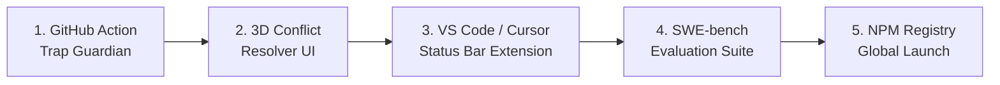

# 🗺️ FastrMemory Planetary Roadmap

High-priority development milestones to establish FastrMemory as the undisputed #1 cognitive memory engine for autonomous AI coding agents:

---

## 📍 Prioritized Milestone Execution

---

### 🛡️ Milestone 1: GitHub Action Pre-Merge Trap Guardian
- **Target File**: `.github/workflows/fastr-guardian.yml`
- **Estimated Effort**: 30 minutes
- **Objective**: Automate pre-merge protection on GitHub Pull Requests.
- **Deliverables**:
  - Automatically runs on `pull_request` triggers.
  - Extracts modified file paths and changed line ranges from the PR diff.
  - Matches changes against active 2.0x error traps in SQLite (`fastrmemory trap list`).
  - Automatically posts GitHub PR review comments highlighting lines violating historical lessons.
  - Fails CI if `--strict` mode is enabled on critical regressions.

---

### 🎨 Milestone 2: 3D Visualizer Conflict & Baserate Studio
- **Target Component**: `ui/src/components/ConflictResolver.tsx` & Three.js Canvas
- **Estimated Effort**: 45 minutes
- **Objective**: Elevate the 3D Brain Observatory into an active decision-making console.
- **Deliverables**:
  - Live 3D visualization of conflicting rule pairs with pulsing red tension wires between nodes.
  - 1-Click Bi-temporal Diff Inspector showing Rule A vs Rule B word-level diffs.
  - Instant resolve button triggering `fastr_resolve` to supersede or weaken the loser.
  - Interactive Kahneman Planning Fallacy calibration chart comparing estimated hours vs actual execution time.

---

### 🧩 Milestone 3: Native VS Code & Cursor IDE Status Bar Extension
- **Target Component**: `extensions/vscode-fastr/`
- **Estimated Effort**: 1 hour
- **Objective**: Real-time ambient memory feedback directly inside the developer's editor.
- **Deliverables**:
  - Lightweight extension packaging status bar pill: `⚡ 3 Traps Active | 98t Packed`.
  - Ambient gutter icons and amber underlines on code lines protected by error traps.
  - Hover tooltip displaying governing rule rationale, author, and timestamp.
  - Quick-command `Ctrl+Shift+P` -> `FastrMemory: Record Error Trap`.

---

### 📊 Milestone 4: SWE-bench & LongMemEval Planetary Benchmark Harness
- **Target Component**: `src/bench/swe-bench.ts` & `src/bench/longmemeval.ts`
- **Estimated Effort**: 1.5 hours
- **Objective**: Provide scientifically rigorous empirical evidence proving superiority over Hippo, Memoria, and mem0.
- **Deliverables**:
  - Multi-session benchmark runner testing 50 real-world repository tasks.
  - Metrics tracked: Trap Recall %, Context Token Bloat (tokens/turn), Hit@1 / Hit@5, and Total Clock Latency.
  - Auto-generated publishable comparison SVG charts and markdown tables for GitHub README and social announcements.

---

### 🚀 Milestone 5: NPM Registry Release & Global Launch
- **Target Package**: `@atifjubaer/fastrmemory`
- **Estimated Effort**: 10 minutes (Scheduled upon completion of 72h NPM cooldown)
- **Objective**: Enable zero-friction global adoption without cloning Git.
- **Deliverables**:
  - Single command execution: `npx @atifjubaer/fastrmemory setup`.
  - Verified provenance signatures for published NPM tarball.
  - Launch announcement on Hacker News, X/Twitter, and r/LocalLLaMA.
