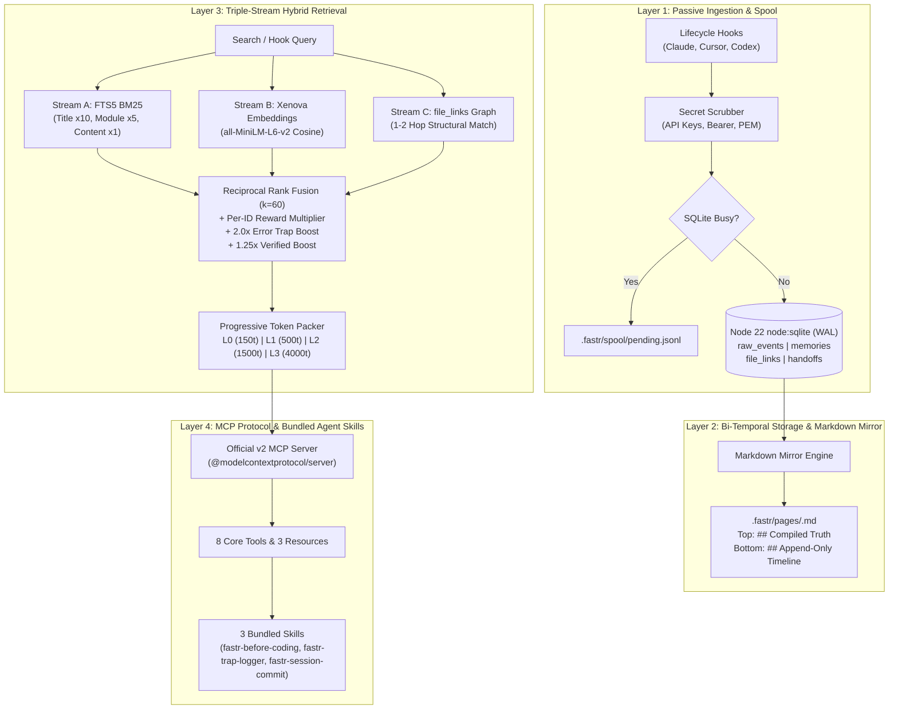

# FastrMemory Architecture Design

> **Package**: `@fastrsoft/fastrmemory`  
> **Company**: Fastrsoft  
> **Target Runtime**: Node.js >= 22.16.0 (ESM, Native `node:sqlite`, WAL mode)  
> **Protocol**: Model Context Protocol (MCP) Official v2 SDK (`@modelcontextprotocol/server`)

---

## 1. Executive Summary & The Problem

AI coding agents (Claude Code, Cursor, Windsurf, Codex) degrade over long-running projects because existing memory engines suffer from critical architectural trade-offs:

1. **Hippo Memory Flaws**:
   - **Lossy Sleep Consolidation**: `hippo sleep` merges multiple detailed episodic memories into a single vague summary, deleting original diffs/traces and causing a **3.6 percentage point drop in Hit@5**.
   - **Disappearing Ink (Time Decay)**: Time-based decay half-lives (7 or 365 days) cause foundational architecture decisions and rare bug fixes to fade if a module isn't touched frequently.
   - **Lexical BM25 Collapses on Paraphrasing**: Default BM25 achieves only **20.0% R@5** on preference queries and **36.3%** on LoCoMo conversational recall.
   - **Classroom Punishment**: Batch `hippo outcome --bad` penalizes every recalled memory in a session, even if only one was erroneous.

2. **AgentMemory Trade-offs**:
   - **Heavyweight Daemon**: Relies on a compiled Rust daemon (`iii-engine`) running on 4 network ports (`3111`, `3112`, `3113`, `49134`), causing native Windows failures and silent memory loss if the process halts.
   - **Context Bloat**: Captures raw keystrokes and voluminous CLI logs indiscriminately, polluting LLM token context with noisy transcripts.

### The FastrMemory Solution

**FastrMemory** synthesizes the best mechanisms from top 2026 memory engines into a zero-daemon, high-performance TypeScript engine:
- **From AgentMemory**: Passive lifecycle hooks, offline `.jsonl` spooling, and 3-way Reciprocal Rank Fusion (RRF, $k=60$).
- **From Graphiti**: Bi-temporal validity timestamps (`valid_from` / `valid_to`) replacing lossy time-decay.
- **From GBrain**: Two-Zone human-readable Markdown pages (`## Compiled Truth` + `## Append-Only Timeline`).
- **From Hippo Memory**: Per-ID outcome feedback, sticky error traps (2.0x boost), and stdio MCP transport.
- **From MemPalace / Letta**: Progressive L0–L3 context token budgeting (~150 token wake-up cost).

---

## 2. Competitive Landscape Comparison

| Feature | kitfunso/hippo-memory | rohitg00/agentmemory | getzep/graphiti | **fastrmemory** |
| :--- | :--- | :--- | :--- | :--- |
| **Daemon Overhead** | Zero daemon (CLI / stdio) | Pinned Rust daemon (4 ports) | Python / Neo4j daemon | **Zero daemon** (Native `node:sqlite`) |
| **Windows Support** | Native Node.js | Requires WSL2 / Docker | Docker / Python | **100% Native Windows & POSIX** |
| **Observation Storage** | Lossy merge deletes originals | Immutable transcripts | Graph edges | **Lossless raw_events + drill** |
| **Validity Model** | Half-life decay | None (Static / Recency) | Bi-temporal intervals | **Bi-temporal (`valid_from`/`valid_to`)** |
| **Search Engine** | BM25 (vectors optional) | BM25 + Vector + Graph RRF | Knowledge Graph search | **BM25 (FTS5) + Vector + Graph RRF** |
| **Markdown Mirror** | Monolithic Markdown dump | Web UI dashboard | Web visualizer | **Two-Zone (Compiled Truth + Timeline)** |
| **Feedback Granularity** | Batch penalty | Passive telemetry only | Edge re-weighting | **Per-ID attribution (`[mem_xxxx]`)** |

---

## 3. The 4-Layer Architecture

---

## 4. The 7 Non-Negotiable Architectural Rules

1. **No Lossy Sleep Merging**:
   Never delete or overwrite raw events. Keep all raw observations immutable in `raw_events`. Summarized memories store up to 32 newest `source_event_ids`. If an agent needs full stack traces, it calls `fastr_drill`.
2. **Bi-Temporal Validity Windows Instead of Time Decay**:
   Memories maintain `valid_from` (ISO timestamp) and `valid_to` (NULL while active, ISO timestamp when superseded). Active queries strictly enforce `WHERE valid_to IS NULL AND status != 'superseded'`.
3. **Staging Quarantine Until Tests Pass**:
   Memories captured during active sessions start with `status = 'staging'`. When automated tests pass or session commit runs, they are promoted to `status = 'verified'` (receiving a 1.25x retrieval boost).
4. **Per-ID Outcome Feedback (No Batch Penalties)**:
   All injected memories are identified by `[mem_xxxx]`. `fastr_feedback` updates only that targeted memory's `reward_score` (+0.2 for good, -0.5 for bad). If a memory receives 3 bad ratings with 0 good ratings, it becomes `dormant`.
5. **GBrain-Style Two-Zone Markdown Mirrors**:
   Each module automatically updates `.fastr/pages/<module>.md` with two git-diffable sections:
   - `## Compiled Truth`: Current active rules, traps, and decisions.
   - `## Append-Only Timeline`: Chronological superseded history with reasons.
6. **Triple-Stream RRF Search ($k=60$) with Session Diversification**:
   Fuses BM25, dense vector cosine similarity, and 1-2 hop file links. Results are capped at a maximum of 3 memories per past session to prevent single-session over-dominance.
7. **Prompt-Cache-Safe Context Injection**:
   Context injection blocks avoid fluctuating timestamps or metrics so LLM prompt caching (Anthropic, Gemini, OpenAI) achieves near 100% cache hits (`skipUnchanged` for 10 turns).

---

## 5. Scoring & Ranking Formula

For a candidate memory $m$ retrieved across streams (BM25, Vector, File Graph):

$$\text{RRF\_Score}(m) = \sum_{s \in \{\text{FTS5}, \text{Vector}, \text{FileLinks}\}} \frac{1}{60 + \text{Rank}_s(m)}$$

$$\text{Final\_Score}(m) = \text{RRF\_Score}(m) \times \text{reward\_score}(m) \times B_{\text{trap}} \times B_{\text{verified}}$$

Where:
- $B_{\text{trap}} = 2.0$ if `kind == 'error_trap'`, else $1.0$
- $B_{\text{verified}} = 1.25$ if `status == 'verified'`, else $1.0$
- $\text{reward\_score} \in [0.1, 3.0]$, default $1.0$
